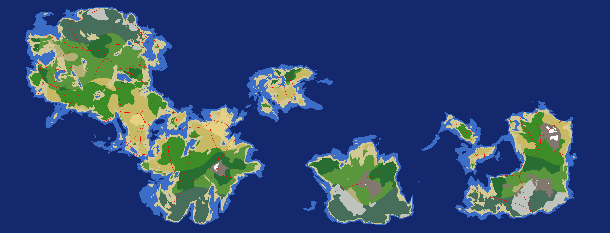
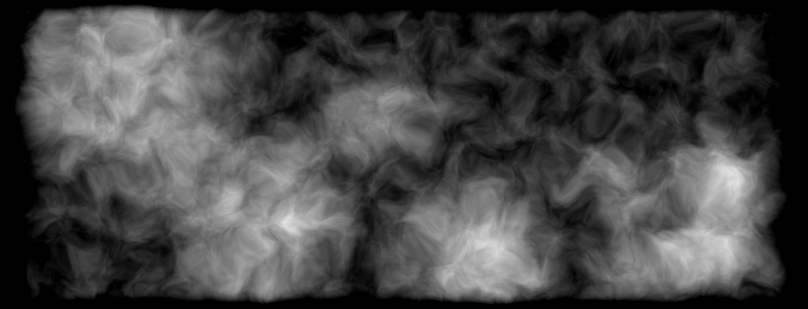
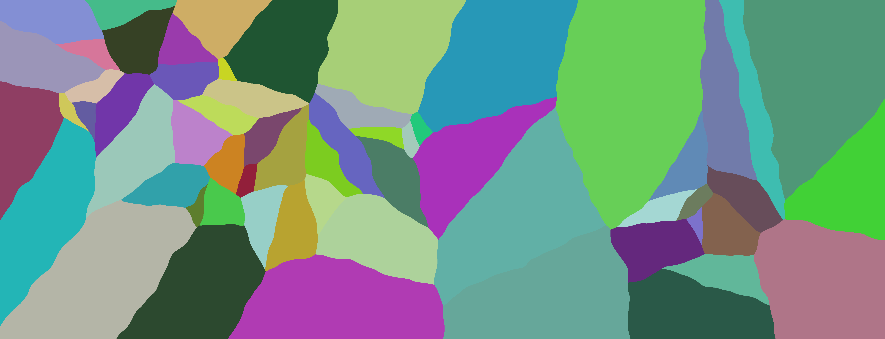

# cpp-world-gen
Simple 2D world generator, configurable via cmd flags (once built).

<details>
<summary><i>Example of a generated Mercator Map with Region Borders</i></summary>

</details>

<details>
<summary><i>Example of a generated heightmap for a Mercator Map</i></summary>

</details>

<details>
<summary><i>Example of a generated region map for a Mercator Map</i></summary>

</details>

### How to build
<details>
<summary><i>Windows</i></summary>

> [!IMPORTANT]
> Since I mainly use the integrated build feature of CLion instead of the cmd, I wrote these instructions with the help of the [CMake Tutorials](https://cmake.org/cmake/help/latest/guide/tutorial/index.html), but I haven't tested them. If you have problems with these instructions, or have tested them but found errors, open a PR with a fix. Thanks!

1. Install [CMake](https://cmake.org/download/)
2. Clone the repository
```
>git clone https://github.com/ILikePapyrus/cpp-world-gen.git
```
3. Navigate inside the folder
```
>cd cpp-world-gen
```
4. Setup the build folder for CMake
```
>cmake -B cmake-build-debug
```
5. Build the project
```
>cmake --build cmake-build-debug
```
6. Move where the executable was created
```
>cd cmake-build-debug
```
7. To use the software, see [Usage](#usage)
</details>

<details>
<summary><i>Linux <b>(Coming soon)</b></i></summary>

>[!NOTE]
>My current Linux environment is not fully set up/working, so when I'll have it running I'll write instructions for Linux. I won't test the build with every major distro, only with Arch (since it's what I use). If you use another distro and have build instructions (which <b>I think</b> could be the same as Windows), open a PR!

</details>

### Usage
Help window:
```cmd
> ./world-gen.exe --help
Usage: world-gen.exe [options]
Options:
  -w, --width <int>       Map width  (default: 1920)
  -h, --height <int>      Map height (default: 1080)
  -m, --merc-map          Generate a Mercator Map (5632x2160) | OVERRIDES -w && -h
  -s, --seed <int>        Noise seed (default: random)
  -f, --frequency <float> Base noise frequency (default: 0.0003)
      --octaves <int>     Fractal Octaves (default: 5)
      --regions <int>     Number of regions (default: 6)
  -o, --output <path>     Output PNG filename (default: date)
  -d, --output-dir <path> Output directory (default: /filename/)
      --help              Show this message
```

### TODO
- [ ] Fix wrong date string on Win11
- [ ] River Generation
- [ ] Biomes
- [ ] Realistic borders
- [ ] Complete README.md
- [ ] Add LICENSE
